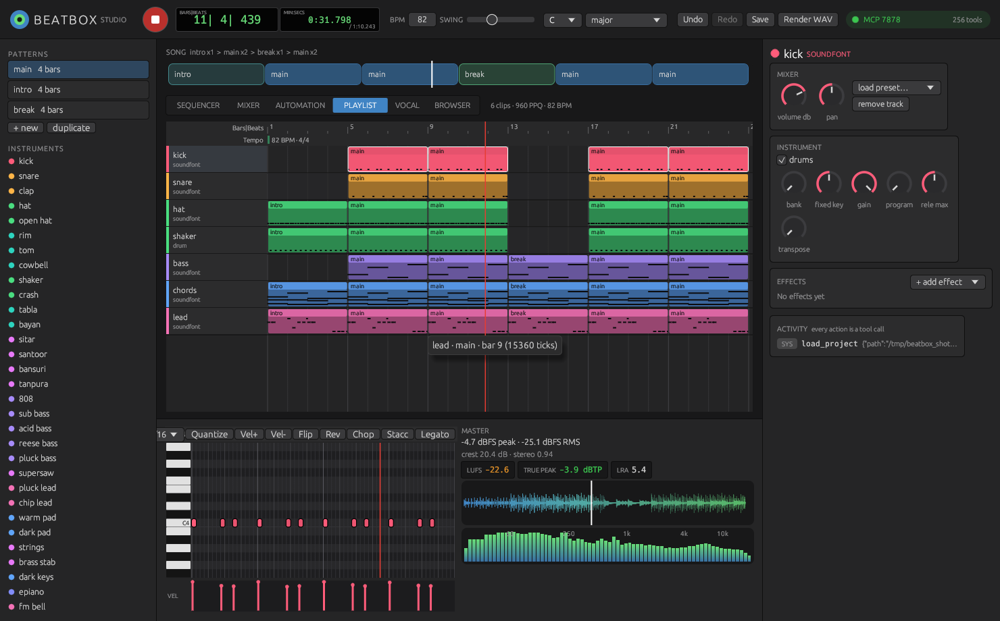
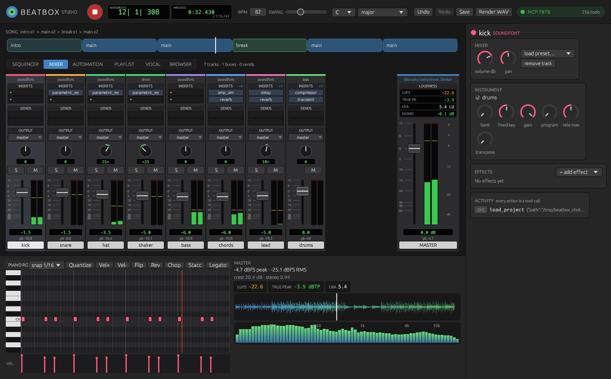
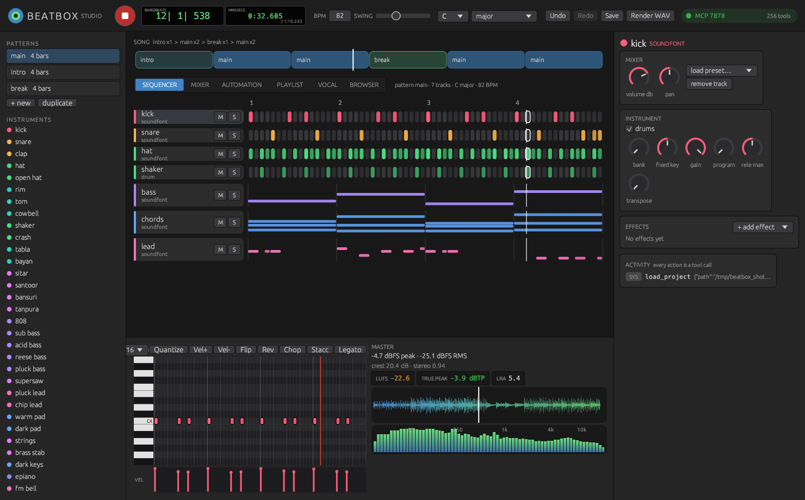
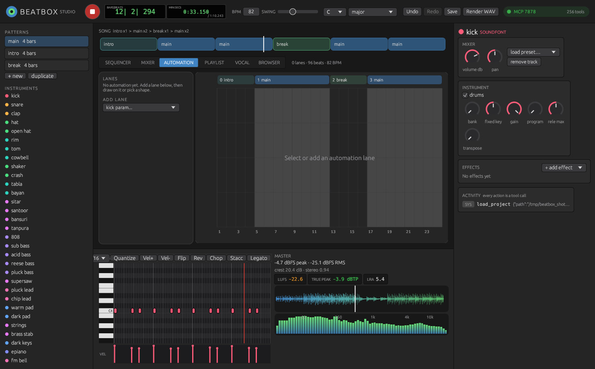
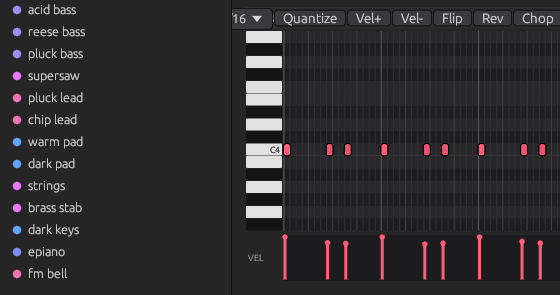
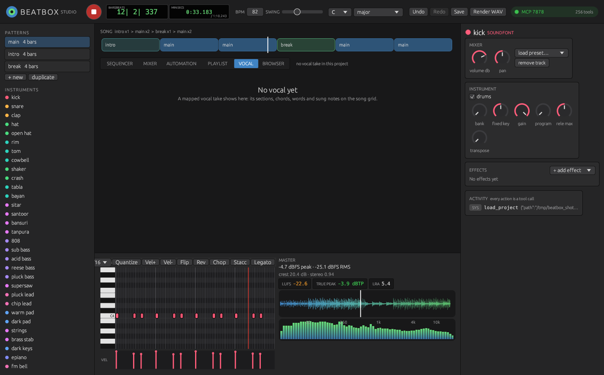

# Beatbox 🥁

**An MCP-first music studio written in Rust.** Every feature (recorded and synthesized instruments, drums, samples, effects, vocals, theory, arrangement, mixing, mastering and mix analysis) is a tool a model can call over [MCP](https://modelcontextprotocol.io): **338 tools** today. People get a CLI and a fully manual native desktop studio (egui) on the same engine; every action in the studio is also an MCP tool, so a model and a person work on the same project.

> FL Studio was built for hands on a mouse. Beatbox is built so that every knob is addressable, every action is undoable, and the engine can *listen back* to its own mix and say what to fix. FL Studio feature parity: **90 of 91** ([docs/FL_PARITY.md](docs/FL_PARITY.md)).


## Why it's different

| | Typical DAW | Beatbox |
|---|---|---|
| Model control | none / plugins | 338 MCP tools, every feature; `batch` makes 50 edits one atomic undo step |
| Instruments | ship with sample packs | real recorded instruments on demand: a General MIDI SoundFont (GeneralUser GS, ~260 instruments), 277 CC0 / CC BY multisampled instruments (electric guitars, basses, acoustic kits, grand and upright pianos, FM keys, Wurlitzer / Pianet / CP80 electric pianos, organs, sax, harmonica, mallets, harps, world percussion, tabla, harmonium, santoor, dholak, tanpura, bansuri, hand claps, ukulele, solo violin, timpani, hand percussion, orchestral cymbals and gong, cymbal swells and wind-chime glisses for transitions) and VSCO 2 CE orchestral packs, fetched with checksums; plus any sound from the web (`import_from_url`); plus modelled piano/ensembles and synths |
| Feedback loop | your ears | `analyze_mix`: LUFS, true peak, spectrum balance, stereo, masking, 0-100 score + fixes |
| Vocals | plugins | channel strip, neural noise removal checked by a speech-quality score, tone matching, flex-time alignment, seamless edits |
| Trying ideas | save-as copies | `snapshot` A/B variants, `diff_project` structured diffs, `compare_variants` renders and scores each |
| Delivery | trust the meters | `validate_project` / `check_master`: overs, true peak, LUFS target, DC, mono, missing samples, broken routing |
| Mistakes | Ctrl+Z if you're lucky | every tool call is undoable, failed calls roll back |
| Format | binary project | one readable JSON file |

## Screenshots

| | |
|---|---|
|  |  |
| **Playlist**: clips over the song, sections, tempo map | **Mixer**: strips with meters, inserts (here `amp_sim`, EQ, chorus, reverb on a recorded guitar), sends, master LUFS / true peak |
|  |  |
| **Step sequencer**: channel rack with per-step velocity, instrument panel | **Automation editor**: lanes and curves over the sections |
|  |  |
| **Piano roll** with the velocity lane | **Vocal view**: takes, clips and edits |

All screenshots are the real studio rendering a real project (`screenshot` tool, headless).

## Real recorded instruments

- **SoundFont player**: a `soundfont` instrument plays SF2 multisamples (rustysynth) in stereo with the font's own panning. `load_instrument {track, instrument:'clean_electric_guitar'}` creates or swaps a track; curated names cover guitars (clean, jazz, muted, overdriven, acoustic, nylon), basses (finger, pick, fretless, upright), pianos, strings, brass, winds, choir and GM drum kits, plus one-drum tracks (`kick`, `snare`, `closed_hat`, `open_hat`, toms, `crash`, `ride`, `tambourine`, `shaker`). `list_instruments` shows every preset; `preview_instrument` renders a short phrase.
- **SFZ instruments**: `search_instruments {query, family, genre, max_mb, license}` searches the catalog (278 entries; families include guitar, bass, drums, percussion, piano, keys, mallets, strings, brass, winds, choir, world; genres such as lofi, indie, jazz, bollywood, classical_indian, latin, afro, cinematic) and `audition_instrument {catalog_id}` renders a 4 s preview (a groove for kits, an arpeggio and chord otherwise) without touching the project; `load_instrument {track, catalog_id}` downloads just the samples one program needs (pinned to a commit, checked against git blob ids, `max_mb` / `max_rr` caps) and builds a multisample track (key zones x velocity layers x round robins). `add_multisample_track {sfz}` loads any local SFZ.
- **Library**: everything lands in `~/.beatbox/library`, never in the project or git. `list_installed`, `remove_instrument`, `cache_limit_mb` (default 1500 MB, least-recently-used eviction). Each catalog entry carries its licence; only CC0, CC BY and MIT-style sources are listed.
- **Amp and cabinet**: `amp_sim` (clean / crunch / lead / bass preamp, tone stack, power amp, modelled 1x12 / 2x12 / 4x12 / bass 4x10 cabinets, level-matched) and `cab_ir` for impulse-response cabinets. `convolution` takes `ir_path` for real recorded rooms, or synthesizes room / hall / plate / chamber / spring / cathedral IRs.
- **Catalog sources**: the sfzinstruments collection (Karoryfer, DrumGizmo, Virtuosity and more), the Versilian Community Sample Library (VCSL, CC0: Steinway and Kawai grands, Yamaha and Knight uprights, TX81Z FM keys, harpsichords, pipe organ, tenor sax, harmonicas, recorders, harps, kalimba, mbira, balafon, marimba, vibraphone, an acoustic drum kit and a world-percussion kit with darbuka, cajon, frame drum, congas and bongos), Greg Sullivan's Wurlitzer EP200, Hohner Pianet T and Yamaha CP80 (CC BY 3.0), the Euterpea Studio harmonium (CC0), a 26-stroke tabla set, santoor rolls, dholak strokes, a tanpura drone and round-robin hand claps (CC0, Freesound), a bansuri (CC BY 4.0, sankalp). [docs/GENRES.md](docs/GENRES.md) lists what each style has and what is still missing. Programs without an .sfz are mapped from their file names and every file is pinned (git blob id or sha256).
- **Anything from the web**: `import_from_url {url}` downloads a WAV/AIFF/FLAC/MP3/OGG (sample), an SF2 (SoundFont track), or a zip/tar.gz (unpacked safely: confined paths, size caps, nothing executable), then loads its SFZ as a multisample track, its one-shots as a kit by drum name, or note-named files as a multisample. `import_from_page {url}` lists the sound links on a page; `freesound_search` / `freesound_fetch` search and pull Freesound sounds (CC0 / CC BY by default; needs `BEATBOX_FREESOUND_KEY`). Every import is recorded in `~/.beatbox/library/sources.json` (URL, page, licence, sha256); `list_imports` shows them and `export_credits` prints the credits a project needs.
- **Disk guard**: downloads refuse to leave less than `BEATBOX_MIN_FREE_MB` (default 2048) free.
- **In the studio**: the Browser view has a SOUND LIBRARY panel: search the catalog, AUDITION / LOAD TO TRACK / +TRACK any entry, import from a URL, see every import and print the credits. Downloads run in the background; each button is the same MCP tool.

## Vocal tools

- **Channel tools** (ported from SoundCraft): `eq_7band`, `eq_1band`, `expander_gate`, `de_ess`, `channel_strip`, and `vocal_clean_chain` (HPF, low-mid dip, presence lift, de-ess, gentle gate, 3:1 comp, level-matched).
- **`denoise_voice`**: DeepFilterNet 3 neural noise removal (RNNoise as the built-in fallback) with an attenuation limit (default 15 dB) and dry/wet mix. It scores the raw take and the result with DNSMOS and only switches the clips when the voice (SIG) and overall (OVRL) scores both improve.
- **`match_vocal_tone`**: corrective EQ from the take's long-term spectrum against a clean close-mic vocal curve or a reference vocal (at most ±6 dB, never lifting bands that sit in the noise floor), plus a dynamic 200-500 Hz cut for boxy moments. Nothing is synthesized.
- **`score_voice_quality`**: DNSMOS P.835 SIG / BAK / OVRL for any samples against a baseline.
- **`analyze_vocal_style`**: reads a take before a beat is chosen: phrase map with stressed syllables, tempo feel (half/double-time candidates, swing), key and mode, sung vs rap, legato vs staccato, a tone descriptor and ranked genre / groove suggestions. **`fit_beat_to_vocal`** then conforms an existing beat to it: swing from the flow, hits under stressed syllables accented, hats softened inside phrases, a kick under an unsupported stress (one per bar at most); undo restores the beat.
- Transcription, tuning, flex-time alignment (`align_vocal_to_grid`, `place_vocal_phrases`), `measure_vocal_vs_beat`, de-hum, de-click, de-reverb, seamless edits that cut between syllables, `vocal_to_song` / `produce_song` from a recording.

## Features

- **Realistic acoustic sources** — a modelled acoustic piano (inharmonic stiff strings, 1-3 detuned strings per key, hammer comb + thump, two-stage decay, soundboard; `grand_piano`, `felt_piano`, `upright_keys`), modelled ensembles (strings / choir / brass sections with per-player vibrato, drift and onset jitter through body/formant spectra: `string_section`, `staccato_strings`, `cello_section`, `choir`, `choir_aah`, `brass_section`), and a **multisample** engine (key zones x velocity layers with crossfades x round robin, SFZ loading). `install_instrument_pack` downloads real CC0 instruments from VSCO 2 Community Edition (upright piano, violin/viola/cello sections sustain/spiccato/pizzicato/tremolo, harp, woodwinds, brass) and maps the zones from the file names, recording the licence.
- **More synth engines** — band-limited **wavetable** synth with 6 morphing tables (position envelope / LFO, automatable), **granular** sampler (grain size, density, position, spray, scan, reverse), **layer** instrument (stack up to 4 sources with key/velocity splits and per-layer delay), stereo unison spread on synths, and **808 / synth glides** (`slide_to` on notes, `glide_ms`).
- **Instruments** — 10 synthesized drum voices (808-style kick, snare, clap, metallic hats, rim, tom, cowbell, shaker, crash), a subtractive synth (polyBLEP oscillators, 9-voice unison/supersaw, SVF filter with envelope + LFO, sub, drive), FM synth (e-piano, bells, mallets), Karplus-Strong plucked strings, an 808 bass, and a pitched sampler. 62 presets.
- **Studio effects** — N-band parametric EQ (bell / shelves / 12-48 dB cuts / notch), 3-band multiband compressor, dynamic EQ, de-esser, soft clipper (oversampled), gate, phaser, flanger, gross-beat-style **stutter** (gate pattern / stutter / half-time / reverse / tape stop, tempo-synced), granular pitch shifter, **convolution reverb** with synthesized room / hall / plate / chamber / spring / cathedral IRs (partitioned FFT), tempo-synced auto-pan / tremolo. Every effect can be bypassed; `describe_effect` / `describe_instrument` return parameter schemas (type, range, unit, enum options) and `set_parameters` changes many at once, atomically.
- **Effects** — filter, 3-band EQ, distortion, bitcrush, tempo-synced ping-pong delay, Freeverb reverb, chorus, compressor, **sidechain ducking**, stereo width, transient shaper, lookahead limiter, modulated delay (`mod_delay`), loudness maximizer (`maximizer`), lo-fi crusher (`lofi`) and rectifier. Per track and on the master.
- **Generators** — 12 drum styles (house, techno, trap, drill, boom bap, lofi, dnb, reggaeton, afrobeats, desi hip-hop, phonk, garage), basslines that follow a progression (808, offbeat, walking…), chords with smooth voice leading (block, stabs, arps…), melodies with motif repetition and chord-tone targeting, and `generate_beat` for a full arranged song in one call.
- **Samples from the internet** — `search_samples` on Freesound (CC0-only by default), `download_sample` by id or any audio URL; wav/mp3/flac/ogg decoding; licenses tracked for credits.
- **Ears** — `analyze_mix` reports peak/RMS, crest factor, energy across sub/bass/low-mid/mid/presence/air, stereo correlation, per-track energy share, low-end masking, and concrete suggestions.
- **Song structure** — patterns (1–64 bars), copy-to-vary, arrangement, WAV render and stem export. `build_structure` turns one full pattern into intro / verse / build / hook / bridge / outro sections by musical role, varies repeats and adds transitions; `add_transition` writes risers, reverse cymbals, impacts, downlifters, fills, filter builds, stutters, tape stops and drop gaps at a boundary (shared patterns are split so only that boundary changes).
- **Piano roll** — select notes by range / pitch / velocity and edit, delete, quantize (strength + swing), split / merge / legato, arpeggiate, strum, rolls / ratchets / flams, chord voicings (inversions, drop-2/3, spread), diatonic harmonize, key detection, velocity shaping, grooves (MPC swing, lazy/Dilla, push) and per-note **probability** and **microtiming**; variations, fills and counter-melodies that stay in key. Standard MIDI File **import / export**.
- **One idea = one call** — `write_riff` (chord-relative figure over a progression, any rhythm, many sections at once), `add_roll`, `write_phrase` (motif repeated with variation / sequence), `copy_notes` (one track between patterns), `add_slides`, `set_section_mix`, `batch`.
- **Samples** — transient `slice_sample` into a playable slice kit, WSOLA `stretch_sample` (tempo-match a loop) and pitch shift, `edit_sample` (trim silence, region in seconds or beats, reverse, fades, normalize peak / LUFS, high-pass), `analyze_audio` (BPM, key, onsets, LUFS, spectrum, width of any sample, file or the mix).
- **Automation** — lanes on any track, bus or the master for `volume`, `pan`, any numeric instrument parameter (`instrument.cutoff`, `instrument.amp_env.release`; sampled per note) or any numeric effect parameter (`fx.0.cutoff`, `fx.2.mix`; evaluated every 64 samples). Breakpoints in song beats with linear / step / smooth curves. `generate_automation` writes musical shapes over a section: riser, sweep down, fade in/out, tempo-synced pump and LFO (`1/8`, `1/4t`, `2 bars`), with log-scaled frequency sweeps.
- **Buses, sends and returns** — named buses with their own effect chains (reverb/room/delay returns, drum bus, parallel comp, glue presets), per-track pre/post-fader sends in dB and output routing to a bus; buses sum into the master before the master chain.
- **A/B variants + diff** — `snapshot` named versions (persisted next to the project by `save_project` and restored by `load_project`), `restore_snapshot` (undoable), `diff_project` returns changes in producer terms (`tracks.bass.volume_db -2 -> -5`, `patterns.A.clips.kick +4 notes`), `compare_variants` renders each version and ranks them by mix score, LUFS and true peak.
- **Robust analysis** — the analyzer measures each track during the render instead of keeping every stem in RAM (a 31-track, 3-minute song no longer exhausts memory), per-track `active_rms_db` / `active_percent` read sparse parts honestly, a panicking tool returns an error instead of killing the MCP server, and every mutation returns its `revision` and an exact `changes` list.
- **Validation + mastering QC** — integrated loudness (ITU-R BS.1770 K-weighting with gating), short-term max, loudness range, 4x-oversampled true peak, DC offset, mono fold-down, silence detection; structural checks for missing samples, broken sends/routing, dead automation, NaN or out-of-range values, notes outside patterns, empty or muted tracks. Every item says pass / warn / fail and which tool fixes it.
- **AI ears (sprint 5)** — `analyze_sections` (per-section LUFS, short-term max, true peak, band balance, top tracks, deltas and flags like *hook not louder than verse*), windowed `analyze_mix`, `detect_artifacts` (clicks, DC steps, end-level jumps after a fade, truncated tails, sustained/looped hiss beds with per-track culprits), `render_spectrogram` and `render_preview` returned as **MCP image / audio content blocks**, `waveform_peaks`, `spectrum`, `eq_curve`, `analyze_track` (YIN fundamental, nearest note vs key, decay), `detect_transients`, `strip_silence`. Key detection uses bass-weighted chroma and reports the top 3 with a confidence margin.
- **Mix balance (sprint 5)** — presets start at calibrated role levels (`add_track` sets the fader; `level_hints` checks levels without a render), `balance_mix` gain-stages the song to genre targets relative to the kick, kick/bass masking is measured after sidechain ducking, suggestions are arrangement-aware.
- **Delivery (sprint 5)** — `export_audio` wav (16/24/32f) / flac (built-in encoder) / mp3 (ffmpeg): target LUFS, true-peak limiting, then encode → decode → re-measure → trim until the *decoded* true peak meets the ceiling; TPDF dither. `export_stems` with bus/return stems, pre/post-master modes and a sum-to-master null check. `master_assistant` (true-peak limiter last, style stage, iterative loudness), `analyze_reference` / `compare_to_reference`. The limiter verifies itself with a 4x oversampled true-peak meter.
- **DSP from SoundCraft (MIT/Apache)** — Kaiser windowed-sinc resampler (sample import and multisample pitching), 8-line FDN reverb (`reverb {mode: fdn_room|fdn_plate|fdn_hall, decay_s}`), soft-knee lookahead compressor with sidechain HPF and parallel mix, YIN pitch detection, spectral-flux transients, TPDF dither and FLAC. See THIRD_PARTY_NOTICES.md.
- **Strict, stable parameters** — unknown top-level or nested parameters are rejected with the valid names (never silently dropped), `add_effect` / `tweak_effect` echo the effective values, and every effect has a stable id (`reverb1`) usable anywhere an index is (`tweak_effect {index:"reverb1"}`, automation `fx.reverb1.mix`); old projects get ids on load.
- **Studio parity** — `transport` (play / stop / seek over the live link), `get_history`, `screenshot` (studio view as an MCP image), `render` with a region and tail.
- **Recording** — the record button in the studio (or `start_recording` / `stop_recording`, `record_audio {seconds}`) captures a microphone or interface input (`list_audio_inputs`) to `recordings/take_N.wav`, registers it as a sample and drops it on a track as an audio clip where recording started; it reports peak, RMS and clipping.
- **LFO tool** — `lfo_tool` (and the piano roll's LFO button) shapes note velocity, gate, timing or chance with a tempo-synced sine, triangle, saw, square or random wave.
- **Studio** — native egui desktop app: arrangement strip, step sequencer, piano roll, **mixer** (channel strips with live meters from stems, faders, pan, sends, bus and master strips with LUFS / true peak), **automation editor** (lane list, curve view over the song with sections, click to add points, one-click shapes), inspector with knobs, live waveform / spectrum and the activity feed. The GUI is fully manual, a hand-operated DAW: the one-call production tools (`make_beat`, `produce_song`, `critique_mix`, ...) live in MCP only. Every click is a tool call, so an MCP client and you share one undo history.

## Install and run from the `tab/frontier` branch

Everything below works on this branch as-is (no merge into `main` needed). Every command was checked against this branch's `beatbox --help`; the build, `beat`, `song_create`, `auto_judge`, `judge_audio`, `render`, `tools` and the MCP stdio handshake were run on it.

**Prerequisites** (Debian/Ubuntu; the same packages CI installs):

```bash
# Rust: rustup reads rust-toolchain.toml and installs the pinned 1.99.0 on the first build
curl --proto '=https' --tlsv1.2 -sSf https://sh.rustup.rs | sh
# build tools, ALSA (audio out), the GUI's window-system libs, and ffmpeg (MP3 export/decoding)
sudo apt-get update
sudo apt-get install -y build-essential pkg-config libasound2-dev libxkbcommon-dev libwayland-dev libx11-dev ffmpeg
```

Python is optional: only `score_voice_quality` (needs numpy + onnxruntime, point `BEATBOX_PYTHON` at it), stem separation and speech-to-song use it. Rendering, mixing and the judge don't.

**Get it and build:**

```bash
git clone -b tab/frontier https://github.com/naman-sharma12345/beatbox-rs.git
cd beatbox-rs
cargo build --release --locked          # -> ./target/release/beatbox
cargo install --path . --locked         # or put `beatbox` on your PATH (~/.cargo/bin)
# headless box (CLI + MCP, no GUI libs needed):
cargo build --release --locked --no-default-features
```

A release build takes several minutes (LTO). On low-RAM machines add `CARGO_PROFILE_RELEASE_LTO=false` and `-j2`.

**Desktop studio (GUI):**

```bash
beatbox studio                 # empty project
beatbox studio song.json       # open a project
```

The studio also listens on `127.0.0.1:7878` (`--listen` to change it), so an AI can drive the open window live (below).

**MCP server** (stdio): `beatbox mcp`. It advertises 19 category tools (`--tools legacy` lists every engine tool by name). Client config (Claude Desktop: `claude_desktop_config.json`; Cursor: `~/.cursor/mcp.json`). Use the absolute path if `beatbox` isn't on the client's PATH:

```json
{
  "mcpServers": {
    "beatbox": {
      "command": "/home/you/.cargo/bin/beatbox",
      "args": ["mcp", "--workdir", "/home/you/beatbox-work"]
    }
  }
}
```

To have the AI work inside the open studio window instead, use `"args": ["mcp", "--connect", "http://127.0.0.1:7878"]` with `beatbox studio` running.

**Render a track from the shell.** Relative paths resolve against `--workdir` (default: the current directory), and the auto judge's setting is stored there too:

```bash
# a full beat in one shot (about 5 s): WAV + project JSON + a mix score
beatbox beat trap --key A --seed 1 -o trap.wav --save trap.json

# turn on the auto judge: every render is checked against a gate profile
# (streaming | club_trap | dnb | balanced) and the verdict rides on the result
beatbox call auto_judge '{"enabled": true, "profile": "balanced"}'

# a whole song from a spec: structure, optional vocal, mix/master, export
beatbox call song_create '{"genre":"trap","seed":1,"structure":[{"kind":"verse","bars":4},{"kind":"hook","bars":4}],"mix":{"builds":true},"export":{"path":"song.wav"}}' --project song.json

beatbox call judge_audio '{"path":"song.wav"}'     # judge any file
beatbox render song.json -o again.wav              # re-render a saved project
beatbox waveform song.json -o song.png --rms     # waveform PNG, no GUI (also any wav/mp3/flac; --lanes stereo|channels)
beatbox tools                                      # what an AI sees
```

`song_create` with a vocal: add `"vocal": {"file": "/path/take.wav"}`. The take is beat-locked and mixed. `beatbox call song_schema '{}'` prints the full spec.

## Quick start

The toolchain is pinned in `rust-toolchain.toml` (the version CI builds with); rustup picks it up automatically. Build against the committed lockfile:

```bash
cargo install --path . --locked                         # desktop studio + CLI + MCP
cargo build --release --no-default-features --locked    # headless (CLI + MCP only, no GUI deps)
# if release linking fails with LTO (some linkers / low-RAM machines):
CARGO_PROFILE_RELEASE_LTO=false cargo build --release --no-default-features --locked
```

MP3 export needs `ffmpeg` on PATH; WAV and FLAC are built in.

```bash

# a full trap beat, rendered and scored
beatbox beat trap --key A -o trap.wav --save trap.json

# call any tool from the shell
beatbox call add_effect '{"track":"lead","type":"reverb","params":{"size":0.9}}' --project trap.json
beatbox call mixer '{"action":"set_mixer","params":{"track":"lead","volume_db":-3}}' --project trap.json
beatbox analyze trap.json
beatbox tools            # the category tools an AI sees (--legacy: every engine tool)
```

## Use it from an AI (MCP)

Add to any MCP client:

```json
{
  "mcpServers": {
    "beatbox": { "command": "beatbox", "args": ["mcp"] }
  }
}
```

Then ask: *"Make a moody indie track at 117 BPM with a clean electric guitar, a finger bass and a real drum kit, put my vocal on it, check the mix and fix whatever it complains about."*

Optional environment: `BEATBOX_FREESOUND_KEY` (or `FREESOUND_API_KEY`; free at freesound.org/apiv2/apply) for Freesound search, `BEATBOX_MIN_FREE_MB` for the download disk guard, `BEATBOX_PYTHON` (a python with numpy + onnxruntime) for `score_voice_quality`, `BEATBOX_LIBRARY` to move the instrument library, `BEATBOX_GITHUB_TOKEN` to raise the rate limit for checked SFZ downloads.


## Why Beatbox beats FL Studio for AI

- **Every action is a typed MCP tool.** Typed JSON schemas cover the whole DAW, so a model drives it directly instead of clicking pixels or scripting around a GUI; small models get a compact tool list plus staged discovery (`list_tool_groups`, `search_tools`, `describe_tool`, `call_tool`, see docs/SMALL_MODEL_GUIDE.md).
- **AI ears with ranked verdicts and fix calls.** `ears_report`, `diff_renders`, `masking_matrix`, `loudness_report`, `groove_analysis` / `hook_analysis` / `structure`, `stereo_image`, `punch`, `vocal_pocket` and `reference_match` return ranked problems, each with the exact tool call that fixes it.
- **Diff-verified revisions.** `produce_track` runs render → critique → `diff_renders` against the best render so far, and keeps a revision only when the ears agree it is better.
- **Nine genre playbooks.** trap, melodic_rap, drill, boom_bap, desi_hiphop (sitar, tabla, tanpura drone), lofi, rnb, phonk and afrobeats, readable with `describe_genre`.
- **Sample flip and vocal chop.** `flip_sample` and `vocal_chop` turn a sample or vocal into playable chops.
- **FL-style workflow, as tools.** Playlist pattern clips, automation clips and mixer bus routing (`place_pattern`, `create_automation_clip`, `route_bus`) with cycle checks.
- **Deterministic project JSON.** The whole song is one readable, stable JSON file, so every change can be diffed, reviewed and undone.

## Tool surface: 19 category tools

An AI client sees **19 tools**, one per category, never more than 24 (a test enforces it). Each tool takes an `action` and that action's arguments:

```json
{"name": "project", "arguments": {"action": "set_tempo", "params": {"bpm": 140}}}
{"name": "generate", "arguments": {"action": "make_beat", "params": {"prompt": "dark trap 140 bpm", "seed": 7}}}
{"name": "effects", "arguments": {"action": "add_effect", "track": "lead", "type": "reverb"}}
```

Arguments go in `params` or flat next to `action`. Each tool's `action` field lists its actions with their arguments; `{"action": "help", "params": {"action": "<name>"}}` returns one action's full schema and a ready example. Four actions have an argument of their own called `action` (`transport`, `perform`, `midi_input`, `playlist_clip`): in flat form, pass it as `op`.

| Tool | Actions | What |
|---|---|---|
| `project` | 15 | Song file and global settings: new/load/save, tempo, key, time signature, tracks, project summary, ids, validation. |
| `history` | 7 | Undo/redo, the edit history, snapshots and restore. |
| `transport` | 10 | Play/stop/seek, render or preview the song, metronome click, record audio input, studio screenshot. |
| `pattern` | 15 | Patterns and drums: step sequencer, drum generators, rolls, fills, ghost notes, groove, swing, humanize. |
| `notes` | 28 | Piano roll: add/edit/delete notes, quantize, transpose, chords, arpeggios, strum, slides, riffs, scales and theory. |
| `midi` | 4 | MIDI files and controllers: import/export .mid, live MIDI input and events. |
| `instrument` | 25 | Instruments and sound design: set/tweak a synth, recorded instrument library (search, fetch, load, preview), multisample packs, macros, resynthesis. |
| `sample` | 27 | Samples: search/download/import audio (Freesound, any URL), sample tracks, slice/stretch/edit, kits, palettes, flips, chops, stem separation, credits. |
| `arrange` | 29 | Song structure and playlist: arrangement, place patterns, clips (move/split/trim/fade), sections, transitions, markers, tempo changes, performance mode. |
| `automation` | 8 | Automation: draw or generate parameter curves (filter sweeps, risers, fades, LFOs) and automation clips. |
| `mixer` | 13 | Mixer: volume, pan, mute, buses, sends, routing, auto-balance, carve space, strip silence, drone notches. |
| `effects` | 15 | Effects: add/tweak/remove/bypass/reorder effects, FX chains, one-knob polish, A/B an effect. |
| `vocals` | 42 | Vocals: add recordings as clips, tune, align to the grid, clean (denoise, de-hum, de-ess, gate), EQ and channel strip, edit, lyrics, vocal-to-song. |
| `analyze` | 28 | Listen and measure: mix analysis, loudness, spectrum, masking, stereo, punch, hooks, structure, artifacts, render diffs, blind A/B tests with a listener. |
| `transcribe` | 11 | Write a recording down as MIDI: drums, bass, melody, chords, FX, arrangement map; identify and analyze a reference song. |
| `generate` | 12 | Make music in one call: make_beat from a prompt or lyrics, drill beats, full-song generators, chords, bass, melody, counter-melody, variations. |
| `produce` | 11 | Whole songs: produce a song from a recording, cover a song around a sung take, song from a reference or vocal, plan/critique/revise loop, QA. |
| `export` | 7 | Master and export: wav/flac/mp3, stems, bounce a track, mastering assistant, check the master, compare to a reference. |
| `help` | 8 | Guide and discovery: how to use this engine, search every action, describe one with an example, run several calls in one undo step. |

**Adding a feature:** add an action to a category (one line in `src/tools_categories.rs`), never a new top-level tool. Tests fail if `tools/list` grows past 24 or if an engine tool is missing from the table or sits in two categories.

**Old names still work.** All 315 fine-grained engine tools stay callable by their own names: `beatbox call set_tempo '{"bpm":140}'`, `tools/call` with the old name, inside `batch`, and through `call_tool`. `beatbox mcp --legacy-tools` (or `BEATBOX_LEGACY_TOOLS=1`, or `--tools legacy`) lists them all again; `--tools compact` keeps the old compact list. `beatbox tools` prints the categories and `beatbox tools --legacy` every engine tool.

New to driving it from a model? Read [docs/SMALL_MODEL_GUIDE.md](docs/SMALL_MODEL_GUIDE.md).

## Architecture

```
            ┌──────────── CLI ────────────┐
 MCP client ┤                             ├─► Engine::call(tool, json) ─► tools registry
            └── Studio (native GUI) ──────┘        │  undo/redo, rollback on error
                                                   ▼
          theory ─► project (JSON) ─► render: instruments → automation → fx → fader
                                        → sends / bus routing → buses → master → WAV
                                                   ▼
                               analysis ("ears": LUFS, true peak) + validate (QC)
```

## Roadmap

- [x] Engine, MCP tools, CLI
- [x] Native desktop studio (egui), fully manual: step sequencer, piano roll, knobs, mixer, live waveform/spectrum, live activity feed (your clicks and MCP calls)
- [x] Studio ↔ MCP live link (`beatbox mcp --connect`) so you watch the AI produce
- [x] Automation lanes, buses/sends/returns, A/B snapshots + diff, validation and master QC
- [x] Piano roll + MIDI import/export, song structure + transitions, studio FX rack, wavetable / granular / modelled piano + ensembles / multisample instruments, sample slicing and stretching, persistent snapshots, batch
- [x] Sprint 5: AI ears (sections, artifacts, spectrogram/preview as MCP media), delivery (codec-aware export, stems, master assistant, reference compare), SoundCraft DSP ports, balance tools, strict params, stable effect ids, transport/history/screenshot
- [x] Sprint 6-7: `produce_track` autonomy loop with diff-verified revisions, AI ears v2/v3, nine genre playbooks, sample flip / vocal chop, FL parity (playlist pattern clips, automation clips, bus routing), saturator + haas, loudness-matched A/B
- [ ] Persistent ids for tracks/clips/notes, clip timeline, scoped edits, golden-render tests

## License

MIT © Naman Sharma

## Sound palettes

`list_palettes` / `apply_palette` swap a project's voices by role to a curated palette: **dark_trap**, **dhh_grit**, **boom_bap_dusty**, **drill_slide**, **melodic_airy** (level-matched, Indian instruments and featured modelled instruments kept). `use_samples:true` uses each palette's CC0 one-shot kit (fetched once, SHA-256 checked; see SAMPLES_LICENSES.md). `audition_palette` renders a palette's voices; `install_palette_samples` indexes the 53 curated CC0 one-shots with role/genre/character tags for `find_samples`. `produce_track` picks the palette for the genre automatically (`palette::for_genre`) and records it in the plan and manifest.

**Mud control (sprint 9b).** Chords played over a bass use open voicings (lowest note B3 or higher, no low thirds, rootless 7ths), and `carve_mix` adds role-sized low cuts and a 320 Hz dip on keys/pads/leads when a bass plays. It runs inside `generate_beat`, `apply_palette` and the producer and never stacks.

**Drill engine.** `make_drill_beat {style: uk|ny|melodic|desi, key, bpm, sections | template, vocal_sample | pauses_s}` writes a whole arranged drill beat on measured drill rules: kick 1/4/7/11 with room for the 808, snare on 3 plus the late and-of-4, 2-2-1 skip hats with one roll per 2 bars, a mono gliding 808 with 1-3 slides per 2 bars, dark piano call/answer, staccato strings, choir and bell; a beat switch with new chords and 808 shapes, risers and impacts into hooks, a drop before each hook, and kick+808 drops wherever the vocal pauses. Every section is its own pattern, so each bar stays hand-editable.

**Desi hip-hop (sprint 9b).** `generate_beat {style: "desi_hiphop"}` writes tabla and dholak tuned to the key, Kafi / Asavari / Bhairav scales, a sitar or bansuri lead with meend glides, harmonium and a tanpura drone (synthesized presets `harmonium`, `dholak`, `dholak_bass`; raag scales kafi, asavari, bhairavi, todi). The voices themselves: mipmapped band-limited oscillators, layered kicks/snares/claps/hats with round-robin variation and velocity tone, an 808 with sub + driven body + click and legato glides.
